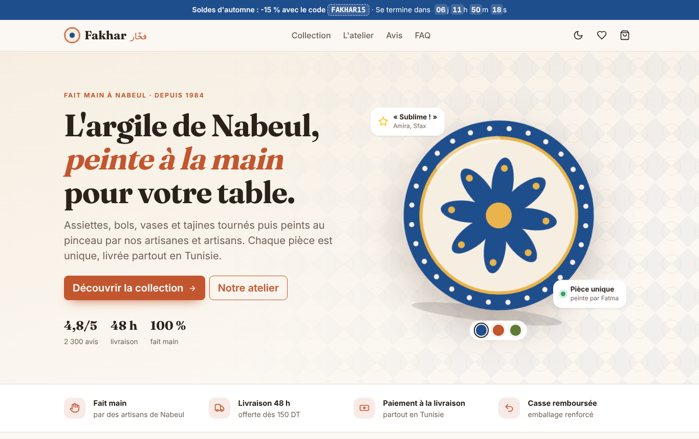
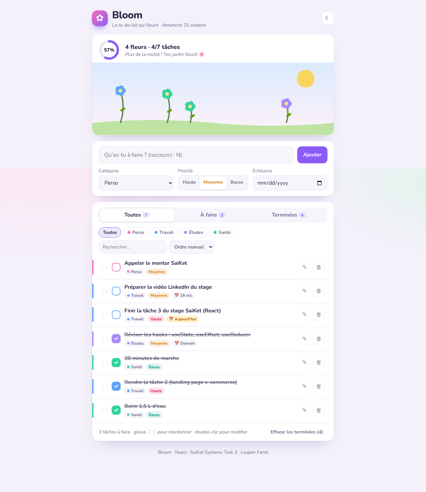
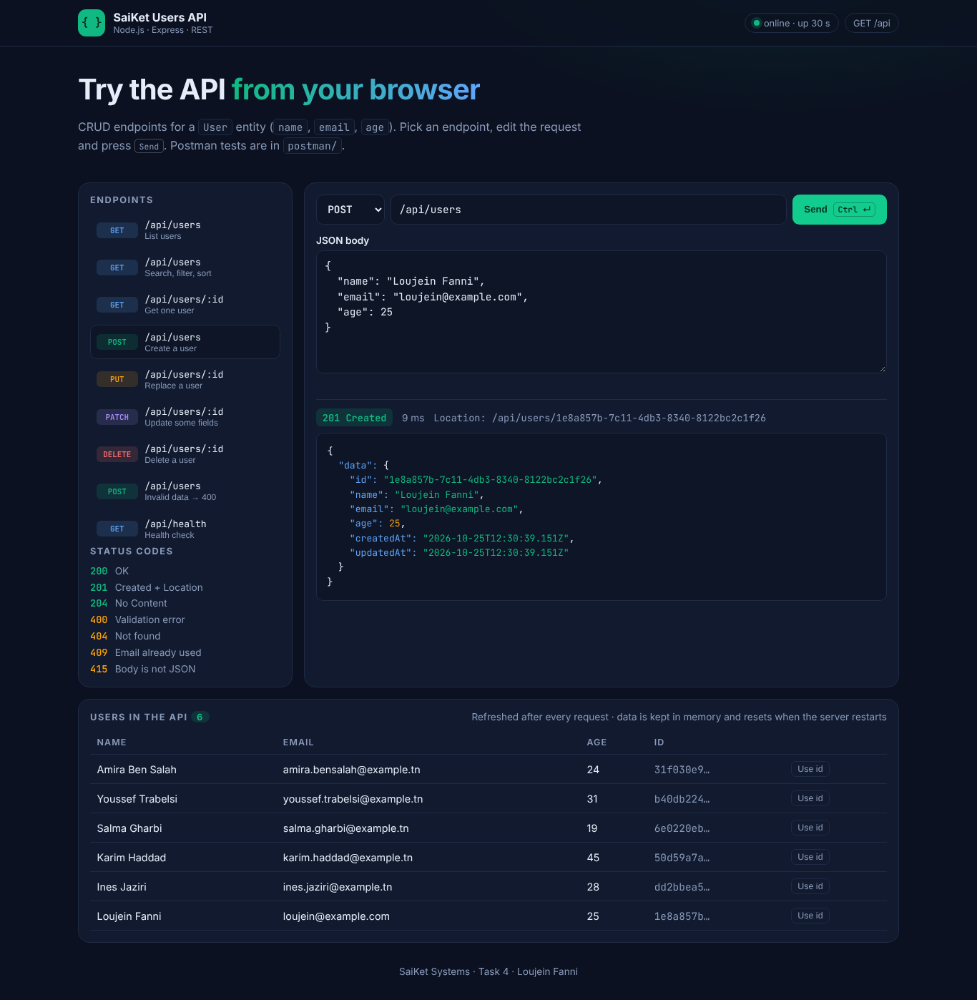
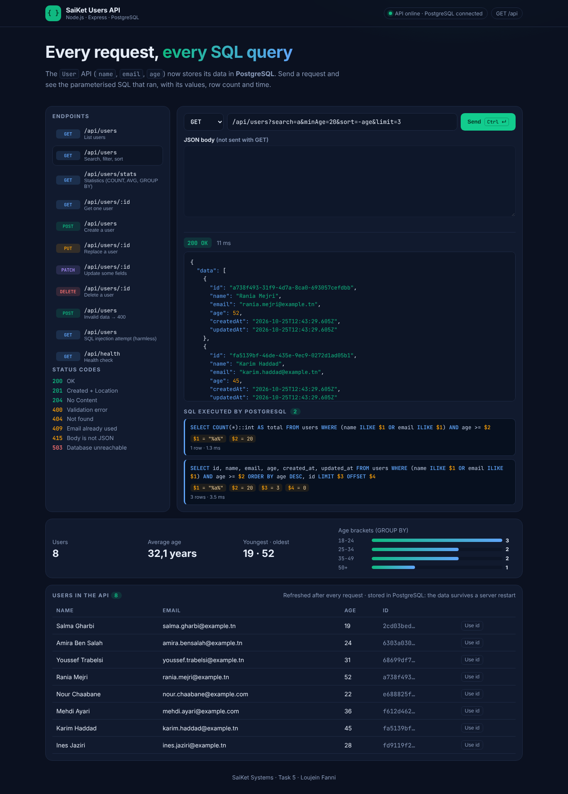

# SaiKet Systems — Full Stack Development Internship

**Intern:** Loujein Fanni · **Duration:** 24/10/2026 → 24/11/2026 · **Mode:** Remote

This repository holds my work for the SaiKet Systems Full Stack Development internship. Each task has its own folder, as the program asks.

| # | Task | Folder | Stack | Status |
|---|---|---|---|---|
| 1 | Static Portfolio Website with a Theme | [`task-1-portfolio`](task-1-portfolio) | HTML · Tailwind CSS · JavaScript | ✅ Done |
| 2 | Responsive Web Page (e-commerce landing) | [`task-2-ecommerce-landing`](task-2-ecommerce-landing) | HTML · CSS · Bootstrap 5 · JavaScript | ✅ Done |
| 3 | Front-End Framework Basics (to-do app) | [`task-3-react-todo`](task-3-react-todo) | React 19 · Vite · Vitest | ✅ Done |
| 4 | Basic REST API (Users CRUD) | [`task-4-rest-api`](task-4-rest-api) | Node.js · Express 5 · Postman | ✅ Done |
| 5 | Database Integration | [`task-5-database-integration`](task-5-database-integration) | PostgreSQL · SQL · Express | ✅ Done |
| 6 | Full Stack Application (User Management) | `task-6-…` | Front-end + API + database | ⏳ Upcoming |

## Task 1: "Rhythm of the Day" portfolio

A portfolio whose theme follows the visitor's real local time (dawn, day, dusk, night), with a sun or moon moving across the sky. The site is bilingual FR/EN and responsive, and its contact form is validated in JavaScript.

Details: [task-1-portfolio/README.md](task-1-portfolio/README.md)

## Task 2: "Fakhar" e-commerce landing page

A responsive landing page for a fictional handmade-ceramics shop from Nabeul. It has filters, search and sorting, a quick view with colour variants, a cart with a promo code and a free-shipping bar, a checkout validated in JavaScript, and a dark mode. It is built with Bootstrap 5 and vanilla JS.

Details: [task-2-ecommerce-landing/README.md](task-2-ecommerce-landing/README.md)

## Task 3: "Bloom" React to-do list

A to-do list where every completed task grows a flower in an animated garden. You can add, edit inline and delete tasks (with undo). Tasks have categories, priorities and due dates, and the list supports filters, sorting, drag & drop and dark mode. It uses useReducer, Context, a custom hook, and has 16 tests.

Details: [task-3-react-todo/README.md](task-3-react-todo/README.md)

## Task 4: Users REST API

A CRUD API for a `User` entity (name, email, age) built with Node.js and Express 5. It has hand-written validation, correct status codes (201, 204, 400, 404, 409, 415), and search, filtering, sorting and pagination. It comes with a **Postman collection (37 assertions)**, 15 automated tests and an API explorer page.

Details: [task-4-rest-api/README.md](task-4-rest-api/README.md)

## Task 5: Database integration (PostgreSQL)

The Task 4 API now stores its users in **PostgreSQL**, using hand-written, parameterised SQL (no ORM). It has constraints (UNIQUE, CHECK), a trigger, indexes, migrations, and statistics computed with COUNT/AVG/GROUP BY. The explorer page shows the SQL executed for every request. It comes with 17 integration tests against a real database and 43 Postman assertions.

Details: [task-5-database-integration/README.md](task-5-database-integration/README.md)

## How to view

Tasks 1 and 2 are static sites: open their `index.html` in a browser. Task 3 is a React app: run `npm install && npm run dev` in its folder. Task 4 is an API: run `npm install && npm start` in its folder. Task 5 needs PostgreSQL too: see its README.

Once GitHub Pages is enabled for this repository, the live version is at
`https://fanniloujein.github.io/saiket-fullstack-internship/task-1-portfolio/`.

---

#SaiKetSystems #saiket #saiketsys #SaiKetInternship
