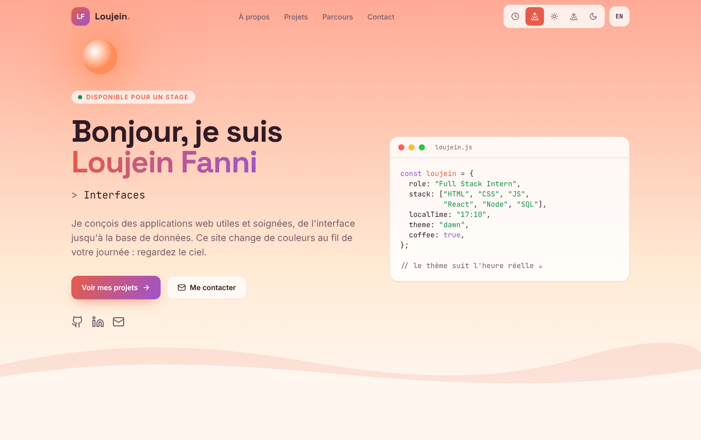
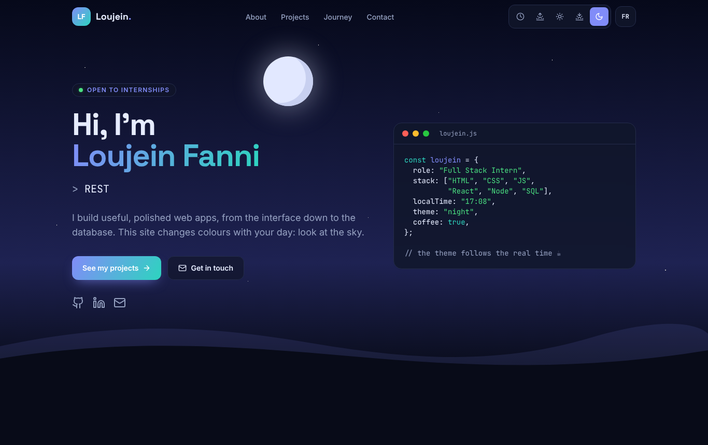
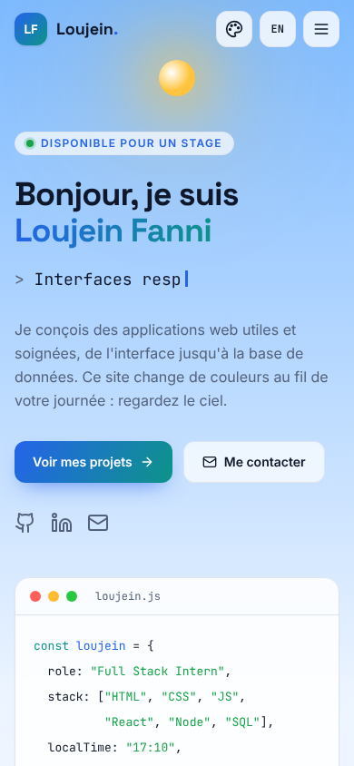
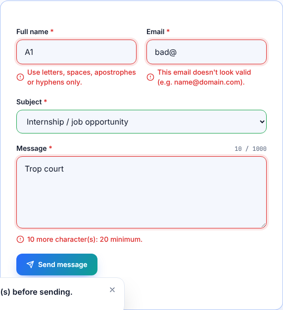

# Task 1 — Static Portfolio Website with a Theme

**SaiKet Systems · Full Stack Development Internship** — Loujein Fanni

> 🇫🇷 Un portfolio « Rythme du jour » : le thème du site suit l'heure réelle du visiteur (Aube, Jour, Crépuscule, Nuit) et un soleil ou une lune traverse le ciel en temps réel.
>
> 🇬🇧 A "Rhythm of the Day" portfolio: the site theme follows the visitor's real local time (Dawn, Day, Dusk, Night) while a sun or moon moves across the sky.



## Requirements checklist

| Requirement | Where |
|---|---|
| Homepage | Hero section: introduction, live code card, call-to-action buttons |
| "Projects" section with placeholders | 7 cards: 1 featured real project, this site, and 5 dashed placeholders for Tasks 2–6, with Front-end / Back-end / Full Stack filters |
| Contact form with JavaScript validation | Name, e-mail, subject and message, validated live in vanilla JS |
| Bootstrap or Tailwind styling | Tailwind CSS 3, compiled to `assets/css/style.css` |
| Responsive and visually appealing | Mobile-first layout, mobile menu, tested at 390 px and 1366 px |

## What makes it original

- **4 time-of-day themes.** In **Auto** mode the palette changes with the hour: dawn 05–09, day 09–17, dusk 17–20, night after that. You can also pick a theme manually. The choice is saved and applied before first paint, so there is no flash of the wrong colours.
- **A live sky.** The sun moves along an arc from 05:00 to 21:00, the moon from 20:00 to 05:00, and stars appear at dusk and night.
- **Bilingual FR / EN.** One click translates the whole page, including validation errors already on screen.
- **Live code card.** It shows the visitor's local time and the current theme.
- Typing effect, scroll-reveal animations, animated counters, scroll progress bar, active link in the menu, back-to-top button, toast notifications.

## Contact form validation

| Field | Rules |
|---|---|
| Name | required, at least 2 characters, letters / spaces / `'` / `-` only (accents allowed) |
| E-mail | required, valid format `name@domain.tld` |
| Subject | an option must be chosen |
| Message | required, 20 to 1000 characters, with a live counter |

- A field is checked when you leave it, then live while you type.
- On submit, every field is checked and focus moves to the first invalid one.
- Errors are accessible: `aria-invalid`, `aria-describedby` and `role="alert"`.
- A hidden *honeypot* field filters out spam bots.
- **Demo mode.** With no back-end, the form validates and confirms but sends nothing. To receive real messages, paste a [Formspree](https://formspree.io) endpoint into `FORM_ENDPOINT` at the top of `assets/js/main.js`.

## Accessibility and quality

- Semantic HTML (`header`, `nav`, `main`, `section`, `article`, `footer`), skip link, visible focus outline.
- Keyboard friendly: <kbd>Esc</kbd> closes the mobile menu, and the filter and theme buttons use `aria-pressed`.
- Respects `prefers-reduced-motion`.
- Works without `localStorage` (private browsing) and without JavaScript (the content stays visible).
- No framework and no runtime dependency: plain HTML, CSS and JavaScript.

## Project structure

```
task-1-portfolio/
├── index.html            # page content (French by default)
├── assets/
│   ├── css/style.css     # compiled Tailwind CSS (generated)
│   └── js/
│       ├── i18n.js       # FR / EN translations
│       └── main.js       # themes, sky, navigation, filters, form validation
├── src/input.css         # Tailwind source: themes + components
├── tailwind.config.js    # colours mapped to CSS variables
└── screenshots/
```

## Run it

Open `index.html` in a browser. No build step is needed to view it.

After editing `index.html`, `src/input.css` or the JS files, rebuild the CSS:

```bash
npx tailwindcss@3 -c tailwind.config.js -i src/input.css -o assets/css/style.css --minify
```

## Personalise before publishing

- [ ] Replace the LinkedIn link (`https://www.linkedin.com/`) in `index.html` with your own profile.
- [ ] (Optional) Add a Formspree endpoint in `assets/js/main.js` to receive messages.
- [ ] Deploy it for free with GitHub Pages, Netlify or Vercel by pointing it at this folder.

## Screenshots

| Night | Mobile (day) | Form validation |
|---|---|---|
|  |  |  |

Full page (dusk): [`screenshots/full-page-dusk.png`](screenshots/full-page-dusk.png)

---

Tags: #SaiKetSystems #saiketsystems #saiket #saiketsys #SaiKetInternship
