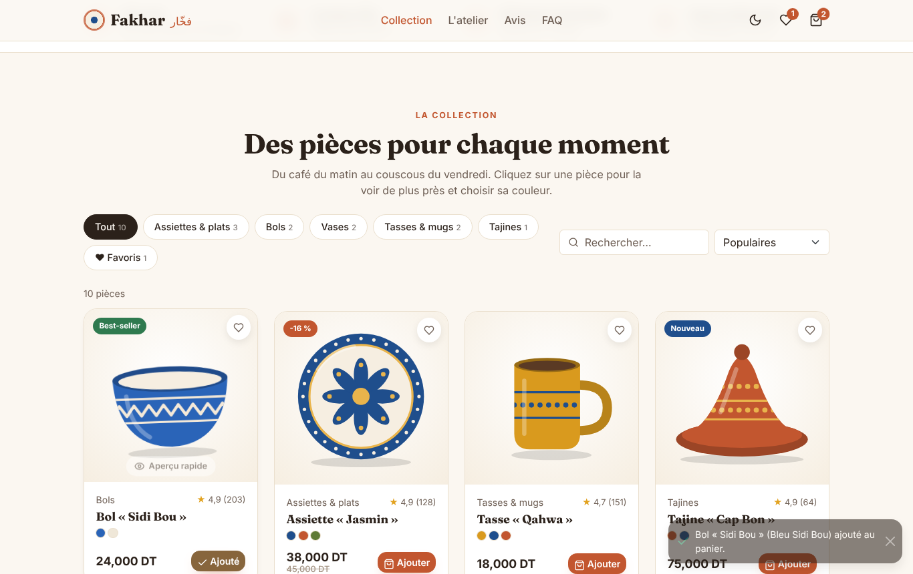
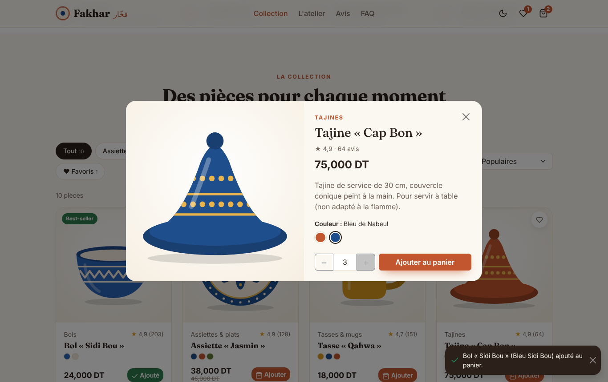
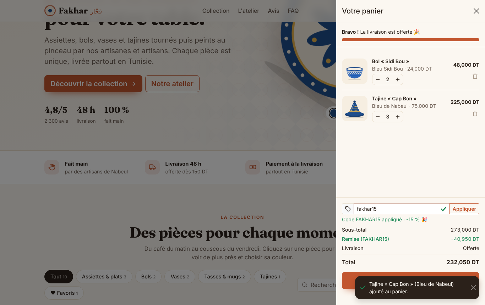
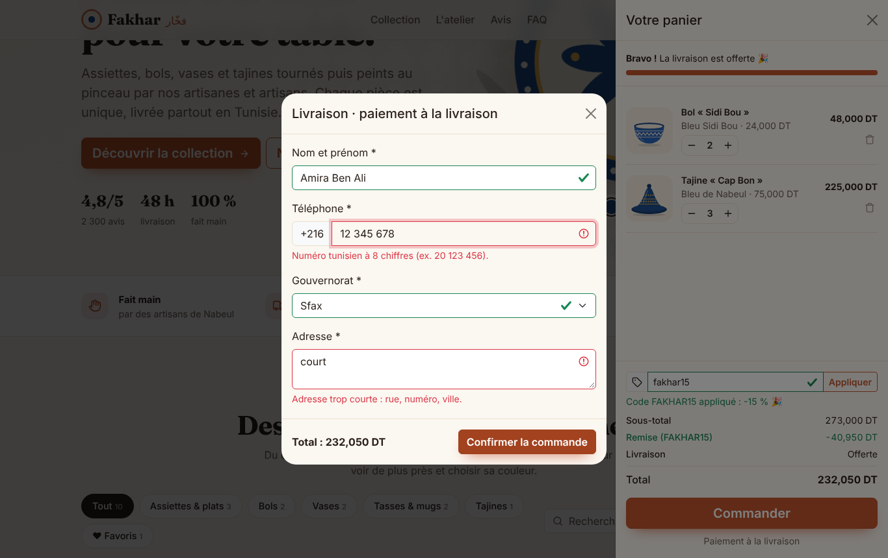
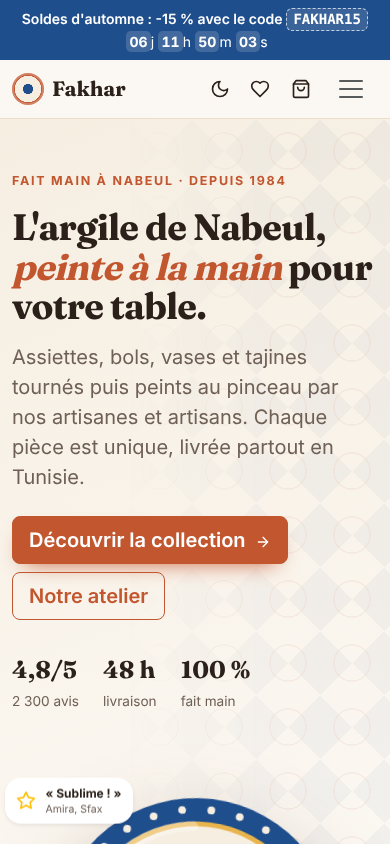

# Task 2 — Responsive Web Page (e-commerce landing page)

**SaiKet Systems · Full Stack Development Internship** — Loujein Fanni

> 🇫🇷 **Fakhar** (فخّار, « poterie ») est la landing page d'une boutique fictive de céramique artisanale de Nabeul (Tunisie). Elle est construite avec **Bootstrap 5** et du **JavaScript natif**.
>
> 🇬🇧 **Fakhar** (Arabic for "pottery") is a landing page for a fictional handmade-ceramics shop from Nabeul, Tunisia, built with **Bootstrap 5** and **vanilla JavaScript**.


## Requirements checklist

| Requirement | Where |
|---|---|
| HTML, CSS and Bootstrap/Tailwind | Bootstrap 5.3 (navbar, grid, offcanvas, modal, carousel, accordion, toast, forms) plus a custom theme in `assets/css/style.css` |
| Responsive web page (e-commerce landing) | Hero, guarantees, collection, workshop, reviews, FAQ and newsletter. Tested at 360 px, 390 px and 1366 px |
| Interactive features in vanilla JavaScript | Form validation, a dark-mode toggle button and the shop features below, in `assets/js/app.js` with no jQuery |
| Basic e-commerce concepts | Catalogue, categories, variants, cart, promo code, shipping fees, free-shipping threshold, checkout |

## Features

**Catalogue**
- 10 products generated from data (`products.js`), with category filters and counters, live search, and sorting (popularity, newest, price, rating).
- A favourites filter.
- Badges: promo with the computed discount percentage, new, best-seller.
- **Original illustrations.** Every piece is drawn as SVG by `ceramics.js` (plate, dish, bowl, vase, mug, tajine) in the colour of the selected variant. No photos are taken from the internet.
- **Quick view** (modal): choose the colour (arrow keys work), choose the quantity, add to cart.
- **Wishlist** ♥ with a counter in the header.

**Cart and checkout**
- **Cart** (offcanvas): change quantities, remove items, see the free-shipping progress bar (threshold 150 DT, otherwise 8 DT), and see totals with Tunisian dinars shown to 3 decimals.
- **Promo codes**: `FAKHAR15` (-15 %) and `BIENVENUE10` (-10 %, given after signing up to the newsletter). An invalid code shows an error.
- **Checkout** (modal, cash on delivery). Each field is validated in JavaScript:
  - name: letters only, at least 3 characters
  - **Tunisian phone number**: 8 digits starting with 2 to 9
  - governorate: required
  - address: at least 10 characters
- A successful checkout shows a demo order number.
- The cart, favourites, promo code and theme are saved in `localStorage` and survive a reload.

**Page features**
- **Newsletter** with e-mail validation.
- **Countdown** to the end of the sale, and a button that copies the promo code.
- **Dark mode** toggle that follows the system setting by default and remembers your choice.
- Reviews carousel, FAQ accordion, toast notifications, and the active menu link follows the scroll.

## Accessibility

- Semantic HTML, skip link, `aria-label` on icon-only buttons.
- Accessible errors with `aria-invalid` and Bootstrap `invalid-feedback`.
- Colour swatches work like a radio group with the keyboard.
- Respects `prefers-reduced-motion`.

## Project structure

```
task-2-ecommerce-landing/
├── index.html
├── assets/
│   ├── css/style.css           # Fakhar theme (light + dark) on top of Bootstrap
│   ├── js/products.js          # catalogue (demo data)
│   ├── js/ceramics.js          # SVG generator for the product illustrations
│   ├── js/app.js               # all interactions
│   └── vendor/bootstrap/       # Bootstrap 5.3.3 (MIT), bundled locally, no CDN needed
└── screenshots/
```

## Run it

Open `index.html` in a browser. There is no build step.

## Screenshots

| Collection | Quick view | Cart |
|---|---|---|
|  |  |  |

| Checkout validation | Mobile | Dark mode (full page) |
|---|---|---|
|  |  | [full-page-dark.png](screenshots/full-page-dark.png) |

---

*Fakhar is a fictional shop created for this exercise. Product names, reviews and figures are demo data.*
