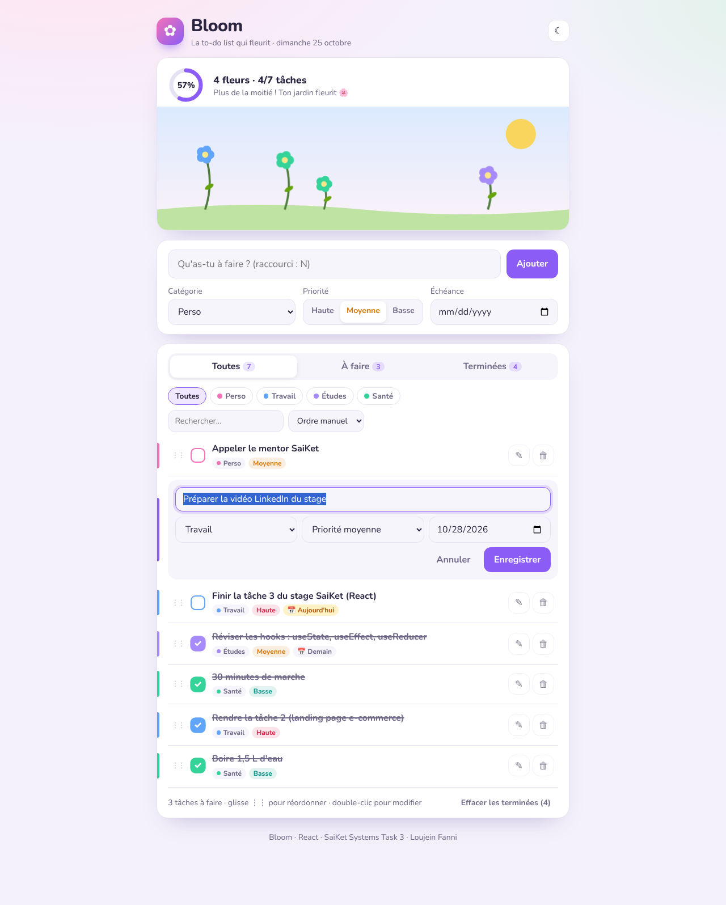
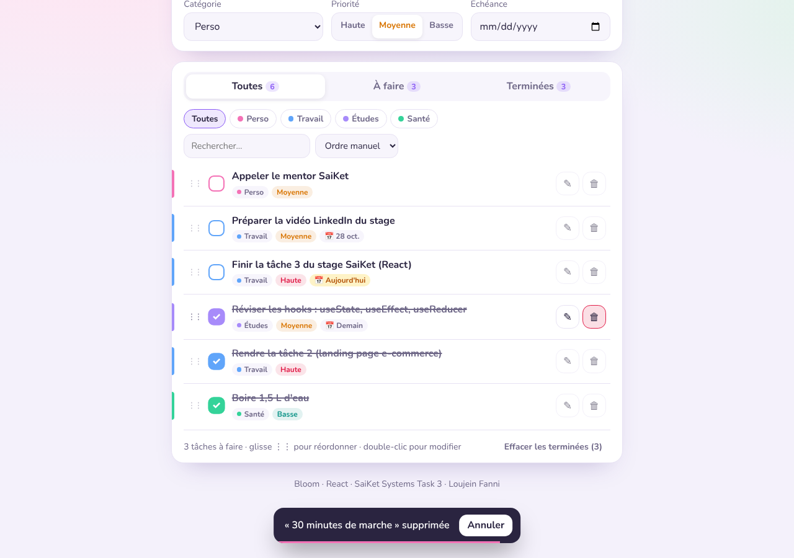
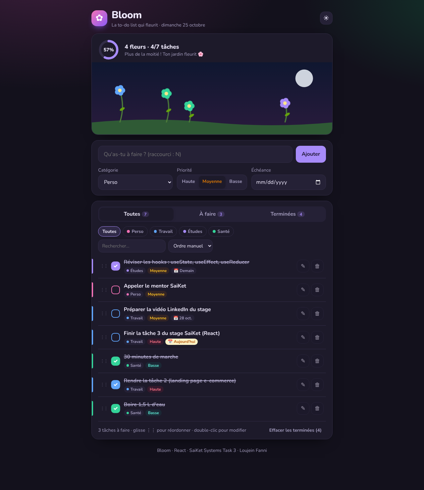
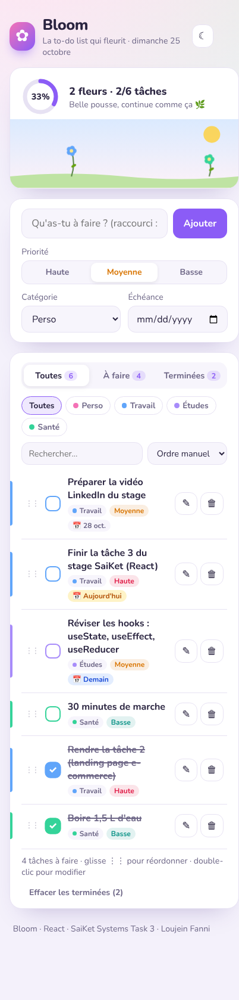

# Task 3 — Front-End Framework Basics (React to-do app)

**SaiKet Systems · Full Stack Development Internship** — Loujein Fanni

> 🇫🇷 **Bloom** est une to-do list en React où **chaque tâche terminée fait pousser une fleur** dans un jardin animé. La couleur de la fleur dépend de la catégorie de la tâche.
>
> 🇬🇧 **Bloom** is a React to-do list where **every completed task grows a flower** in an animated garden. The flower's colour matches the task's category.

**🌐 Live demo:** https://task-3-react-todo.onrender.com/


## Requirements checklist

| Requirement | Where |
|---|---|
| Learn React and build a small app such as a to-do list | Vite + React 19 app in `src/` |
| **Add** tasks | `TaskForm.jsx`, a controlled form with validation |
| **Edit** tasks | `TaskItem.jsx`, inline editing of the title, category, priority and due date (button or double-click, <kbd>Enter</kbd> saves, <kbd>Esc</kbd> cancels) |
| **Delete** tasks | Delete button, with **Undo** for 5 seconds (`UndoToast.jsx`), plus "Clear completed" |
| Show the framework's core features | See the table below |

## React concepts shown

| Concept | Where it is used |
|---|---|
| Components and **props** | `Header`, `Garden`, `TaskForm`, `Toolbar`, `TaskList`, `TaskItem`, `UndoToast` |
| `useState` | Form fields, filters, edit mode, drag & drop |
| `useReducer` | All task changes go through a pure reducer: `state/tasksReducer.js` (add, toggle, edit, delete, restore, move, clearCompleted) |
| `useEffect` and **cleanup** | Saving to storage, the <kbd>N</kbd> keyboard shortcut, the auto-closing undo timer |
| `useMemo` | Filtered and sorted list, counters, flower positions |
| `useRef` | Focusing the input (shortcut, edit mode) |
| `useCallback` | Stable callback for the toast timer |
| **Context** (`createContext` / `useContext`) | Light/dark theme in `ThemeContext.jsx` |
| **Custom hook** | `useLocalStorage`: tasks and theme survive a reload |
| Lists and `key`, conditional rendering, controlled inputs, derived state | Throughout the app |

## Features

- Categories (Personal, Work, Studies, Health), each with its own colour.
- Priority (high, medium, low) and a due date. The date badge reads *Today*, *Tomorrow* or *Overdue*.
- Filters by status (all / to do / done) with counters, by category, and by search.
- Sorting: manual order (**drag & drop**), due date, priority, newest.
- The **garden** and a **progress ring** grow as you complete tasks, with an encouraging message.
- Dark mode, responsive layout, keyboard friendly, `aria` labels, and support for reduced motion.

## Tests

16 automated tests with **Vitest** and **React Testing Library**, in `src/test/`:

- **Reducer:** add, toggle, edit, delete and restore, move, immutability.
- **App:** add, validation error, complete a task, edit, delete and undo, filter, persistence.

```bash
npm test
```

## Run it

Requires Node.js 22.12 or later.

```bash
cd task-3-react-todo
npm install
npm run dev        # http://localhost:5173
npm run build      # production build in dist/
```

### Deploy on Render (Static Site)

| Field | Value |
|---|---|
| Root Directory | `task-3-react-todo` |
| Build Command | `npm install && npm run build` |
| Publish Directory | `dist` |

## Structure

```
src/
├── main.jsx              # entry point (StrictMode + ThemeProvider)
├── App.jsx               # state, filters, sorting, undo
├── ThemeContext.jsx      # Context for the light/dark theme
├── state/tasksReducer.js # pure reducer + validation
├── hooks/useLocalStorage.js
├── utils/dates.js
├── components/           # Header, Garden, TaskForm, Toolbar, TaskList, TaskItem, UndoToast
├── styles.css
└── test/                 # Vitest + Testing Library
```

## Screenshots

| Inline edit | Undo after delete | Dark mode | Mobile |
|---|---|---|---|
|  |  |  |  |
