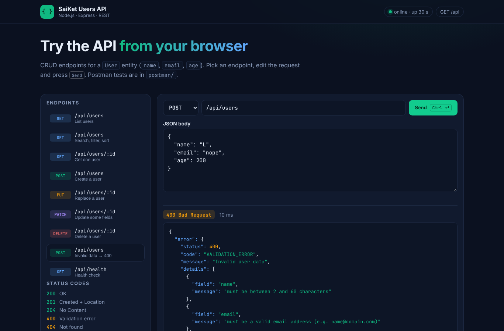
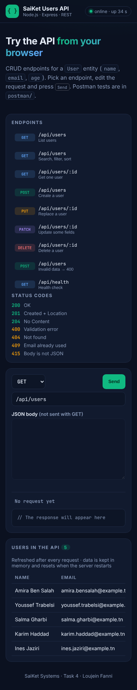

# Task 4 — Build a Basic REST API (Node.js + Express)

**SaiKet Systems · Full Stack Development Internship** — Loujein Fanni

> 🇫🇷 API REST pour une entité **User** (`name`, `email`, `age`) avec Node.js et Express 5 : les 4 opérations CRUD, une validation complète, des codes HTTP corrects, une collection **Postman** (37 assertions), 15 tests automatiques et une page « API explorer » pour tester depuis le navigateur.
>
> 🇬🇧 A REST API for a **User** entity (`name`, `email`, `age`) built with Node.js and Express 5. It has full CRUD, complete validation, correct HTTP status codes, a **Postman** collection (37 assertions), 15 automated tests and an "API explorer" page for testing from the browser.


## Requirements checklist

| Requirement | Where |
|---|---|
| Node.js and Express basics | `src/app.js`, `src/server.js`, Express 5 |
| CRUD endpoints for a `User` (name, email, age) | `src/routes/users.js` |
| JSON handling | `express.json()`, JSON responses, JSON errors |
| REST API design | Resources, HTTP verbs, status codes, `Location` header, pagination |
| **Postman testing** | `postman/SaiKet-Users-API.postman_collection.json`: 16 requests and **37 assertions, all passing** (see [`postman/newman-report.txt`](postman/newman-report.txt)) |

## Endpoints

| Method | URL | Description | Success |
|---|---|---|---|
| `GET` | `/api/users` | List users | `200` |
| `GET` | `/api/users/:id` | Get one user | `200` |
| `POST` | `/api/users` | Create a user | `201` + `Location` header |
| `PUT` | `/api/users/:id` | Replace a user (all fields) | `200` |
| `PATCH` | `/api/users/:id` | Update some fields | `200` |
| `DELETE` | `/api/users/:id` | Delete a user | `204` |
| `GET` | `/api/health` | Health check | `200` |
| `GET` | `/api` | List of endpoints | `200` |

**Query options for the list:** `?search=amira&minAge=18&maxAge=40&sort=-age&page=1&limit=10`

- `sort` accepts `name`, `email`, `age` or `createdAt`. Prefix with `-` for descending order.
- `limit` must be between 1 and 100.

The response looks like this:

```json
{
  "data": [{ "id": "…", "name": "Amira Ben Salah", "email": "amira.bensalah@example.tn", "age": 24, "createdAt": "…", "updatedAt": "…" }],
  "meta": { "total": 5, "page": 1, "limit": 10, "pages": 1 }
}
```

## Validation and errors

| Field | Rule |
|---|---|
| `name` | Text of 2 to 60 characters: letters, spaces, `'`, `.` and `-` (accents allowed) |
| `email` | Valid format, **unique**, saved in lowercase |
| `age` | Integer between 1 and 120 |
| Other fields | Rejected, which stops a client from sending `role: "admin"` |

Every error has the same shape and lists the problems field by field:

```json
{
  "error": {
    "status": 400,
    "code": "VALIDATION_ERROR",
    "message": "Invalid user data",
    "details": [{ "field": "email", "message": "must be a valid email address (e.g. name@domain.com)" }]
  },
  "requestId": "4f1c…"
}
```

| Code | When |
|---|---|
| `400` | Invalid data, broken JSON, or bad query parameters |
| `404` | User or route not found |
| `409` | Email already used |
| `415` | Body is not sent as JSON |
| `500` | Unexpected error (the details are logged, not shown) |

## Architecture

```
src/
├── server.js                # starts the server (PORT, default 3000)
├── app.js                   # builds the Express app (also used by the tests)
├── routes/users.js          # the CRUD endpoints
├── validation/user.js       # hand-written validation rules (body + query)
├── store/memoryUserStore.js # in-memory data with async methods
├── middleware/index.js      # request id, logger, CORS, JSON required, 404, error handler
└── utils/httpError.js
public/                      # API explorer (HTML + vanilla JS)
postman/                     # Postman collection, environments, Newman report
tests/users.test.js          # 15 tests (node:test + supertest)
```

The **store** layer has async methods (`findAll`, `findById`, `create`, `update`, `remove`). In Task 5 it is replaced by a SQL database without changing the routes.

## Run it

```bash
cd task-4-rest-api
npm install
npm start           # http://localhost:3000  (API explorer on the home page)
npm test            # 15 automated tests
```

## Test with Postman

1. Open Postman, click **Import** and select the two files:
   - `postman/SaiKet-Users-API.postman_collection.json`
   - `postman/local.postman_environment.json`
2. In the top-right corner, choose the environment **SaiKet API — local**.
3. Start the API with `npm start`.
4. Right-click the collection, choose **Run collection**, then click **Run**.

All 37 tests should be green. The collection creates a user, reads it, updates it and deletes it, and it also checks the error cases (400, 404, 409).

From the command line, with Newman (Postman's runner):

```bash
npm run test:postman
```

To test the online version, edit `postman/render.postman_environment.json` with your Render URL.

## Deploy on Render (Web Service)

| Field | Value |
|---|---|
| Root Directory | `task-4-rest-api` |
| Runtime | Node |
| Build Command | `npm install` |
| Start Command | `npm start` |

> The data is kept in memory, so it resets when the server restarts. A free Render service also goes to sleep. **Task 5** adds a real SQL database.

## Screenshots

| Validation error (400) | Mobile |
|---|---|
|  |  |
