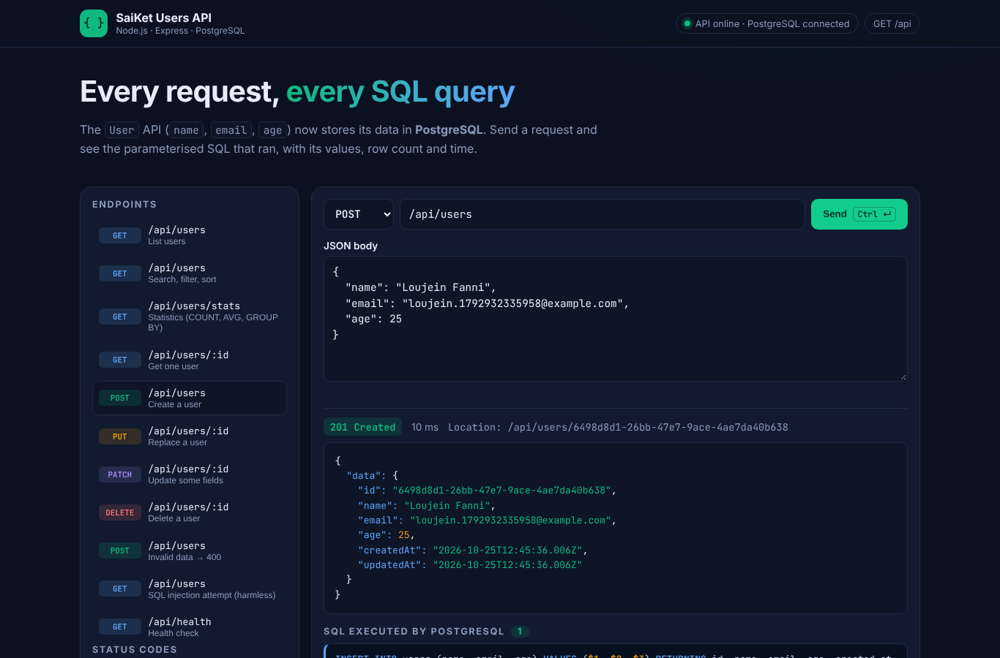
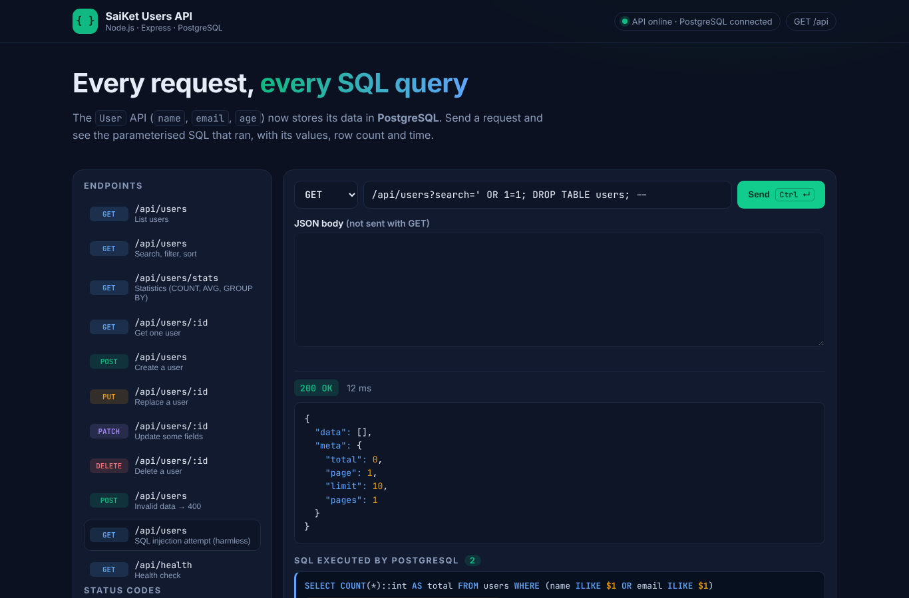
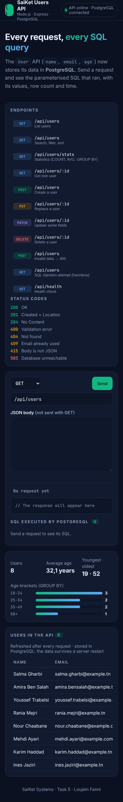

# Task 5 — Database Integration (PostgreSQL)

**SaiKet Systems · Full Stack Development Internship** — Loujein Fanni

> 🇫🇷 L'API « Users » de la tâche 4 est maintenant connectée à **PostgreSQL**. Elle utilise des requêtes **SQL écrites à la main** et paramétrées (sans ORM), des contraintes en base, des migrations et des statistiques en SQL. La page d'exploration affiche **le SQL exécuté** pour chaque requête.
>
> 🇬🇧 The Task 4 "Users" API is now connected to **PostgreSQL**. It uses **hand-written, parameterised SQL** (no ORM), database constraints, migrations and SQL statistics. The explorer page shows **the SQL executed** for every request.


## Requirements checklist

| Requirement | Where |
|---|---|
| Learn the basics of SQL | [`sql/practice-queries.sql`](sql/practice-queries.sql): SELECT, WHERE, ORDER BY, LIMIT/OFFSET, INSERT, UPDATE, DELETE, RETURNING, COUNT/AVG/MIN/MAX, GROUP BY, HAVING |
| Connect the REST API to MySQL or PostgreSQL | **PostgreSQL 16** with the `pg` driver and a connection pool (`src/db/pool.js`) |
| Store and retrieve name, email and age | The `users` table ([`sql/migrations/001_create_users.sql`](sql/migrations/001_create_users.sql)) |
| SQL queries inside the API endpoints | [`src/store/pgUserStore.js`](src/store/pgUserStore.js), used by every route |
| Express basics | Same routes as Task 4, plus `GET /api/users/stats` |

## How each endpoint uses SQL

| Endpoint | SQL |
|---|---|
| `GET /api/users` | `SELECT … WHERE (name ILIKE $1 OR email ILIKE $1) AND age >= $2 … ORDER BY … LIMIT $n OFFSET $m`, plus `SELECT COUNT(*)` |
| `GET /api/users/stats` | `COUNT`, `AVG`, `MIN`, `MAX`, `GROUP BY` age bracket and email domain |
| `GET /api/users/:id` | `SELECT … WHERE id = $1` |
| `POST /api/users` | `INSERT INTO users (name, email, age) VALUES ($1, $2, $3) RETURNING …` |
| `PUT` / `PATCH /api/users/:id` | `UPDATE users SET name = $2, … WHERE id = $1 RETURNING …` (only the fields that were sent) |
| `DELETE /api/users/:id` | `DELETE FROM users WHERE id = $1` |

## Good database practice

- **Parameterised queries** (`$1`, `$2`…): values never go into the SQL text, which stops SQL injection. A test and a Postman request send `' OR 1=1; DROP TABLE users; --`: nothing matches and the table is still there.
- **Column names come from a whitelist** for `ORDER BY`, because a column name cannot be a parameter.
- The **wildcards** `%` and `_` are escaped in searches.
- **Constraints in the database**, so the data stays valid even without the API:
  - `PRIMARY KEY` as a UUID
  - `UNIQUE (email)`
  - `CHECK` that age is between 1 and 120, that the email is lowercase, and that the name is 2 to 60 characters
  - `NOT NULL` on the required columns
- **Errors are translated**: a duplicate email (PostgreSQL code `23505`) returns **409**, and an unreachable database returns **503**.
- A **trigger** updates `updated_at` automatically on every `UPDATE`.
- **Indexes** on `age` and `created_at` speed up the filters and sorts.
- **Migrations**: `sql/migrations/*.sql` files are applied once each, inside a transaction, and tracked in `schema_migrations`.
- On a new database, the server **creates the table and adds the sample users** at startup.
- The pool closes cleanly on shutdown (`SIGTERM`).

## Run it locally

You need **Node.js 22.9+** and **PostgreSQL 14+**.

```bash
cd task-5-database-integration
npm install
cp .env.example .env             # then edit DATABASE_URL
```

Create the database. Here is an example with `psql`. With pgAdmin, simply create a database:

```sql
CREATE ROLE saiket LOGIN PASSWORD 'saiket' CREATEDB;
CREATE DATABASE saiket_users OWNER saiket;
CREATE DATABASE saiket_users_test OWNER saiket;   -- used by npm test
```

Then:

```bash
npm start            # applies the migrations, adds the sample users, starts on http://localhost:3000
npm run db:reset     # empties the table and reloads the sample users
npm test             # 17 integration tests against PostgreSQL (TEST_DATABASE_URL)
npm run test:postman # Postman collection with Newman (the API must be running)
```

## Tests

- **17 integration tests** run against a real PostgreSQL database (`node:test` + `supertest`). They cover:
  - filters, search, sorting and pagination
  - SQL injection
  - the UNIQUE constraint returning 409
  - the trigger on `updated_at`
  - persistence between two app instances
  - statistics, the CHECK constraint, and the SQL header
- **Postman:** 18 requests and **43 assertions, all passing**. See [`postman/newman-report.txt`](postman/newman-report.txt).
  - Import `postman/SaiKet-Users-API.postman_collection.json` and `postman/local.postman_environment.json`.
  - Then run **Run collection**.

## "SQL executed" panel (learning feature)

For every request, the API sends the executed SQL in the `X-Sql-Queries` header. That includes the query text, the parameter values, the number of rows and the time. The explorer page (`/`) displays it. It is only for learning: turn it off with `SHOW_SQL=false`.

## Deploy on Render

**Option 1, automatic (recommended).** Render → **New → Blueprint** → this repository, with the Blueprint path set to `task-5-database-integration/render.yaml`. This creates the PostgreSQL database **and** the web service, already connected.

**Option 2, by hand:**

1. Create a **PostgreSQL** database on Render.
2. Create a **Web Service** with:
   - Root Directory: `task-5-database-integration`
   - Build Command: `npm install`
   - Start Command: `npm start`
3. Set the environment variable `DATABASE_URL` to the database's **Internal URL**.

> A free Render PostgreSQL database is temporary (Render deletes it after a while). For a longer-lasting demo, use a free [Neon](https://neon.tech) database and set `DATABASE_SSL=true`.

## Structure

```
sql/
├── migrations/001_create_users.sql  # table, constraints, indexes, trigger
├── seed.sql                         # 8 sample users
└── practice-queries.sql             # annotated SQL exercises
src/
├── db/pool.js            # pg pool + query() (records the SQL for the explorer)
├── db/migrate.js         # migrations and seeding
├── db/cli.js             # npm run db:migrate | db:seed | db:reset
├── store/pgUserStore.js  # all the SQL queries of the API
├── routes/users.js       # endpoints (unchanged from Task 4, plus /stats)
├── validation/user.js    # validation before touching the database
├── middleware/index.js   # request id, logger, CORS, SQL header, errors
├── app.js / server.js
public/                   # API explorer with the SQL panel
postman/                  # collection, environments, Newman report
tests/users.test.js       # 17 tests against PostgreSQL
render.yaml               # Render Blueprint (database + API)
```

## Screenshots

| INSERT with parameters | SQL injection attempt | Mobile |
|---|---|---|
|  |  |  |
