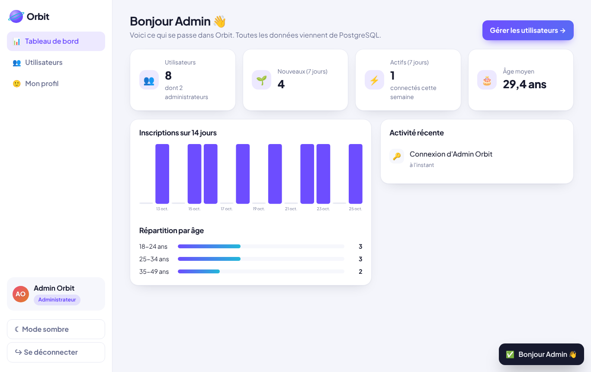
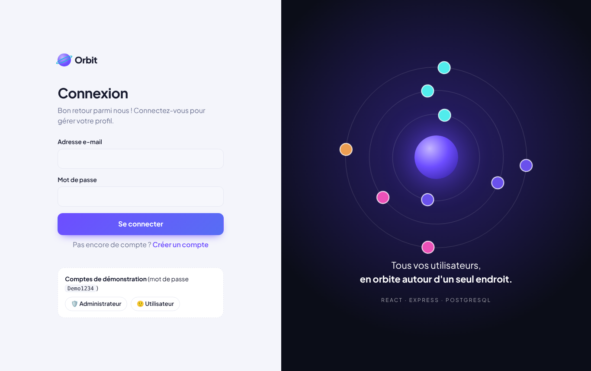
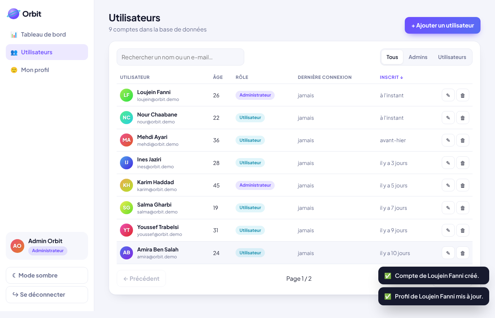
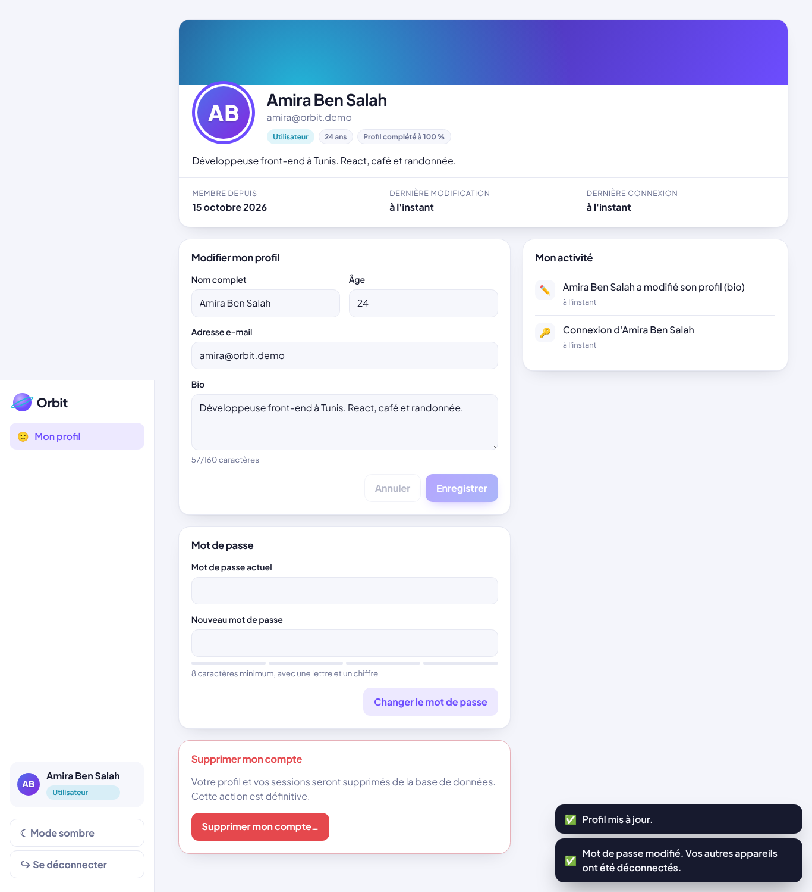
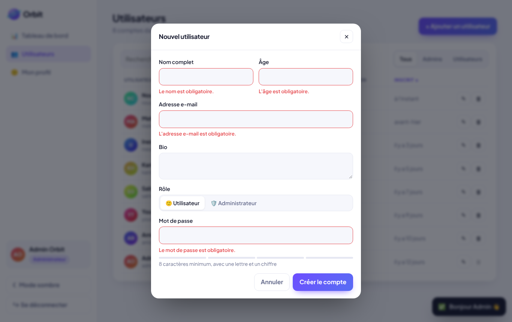
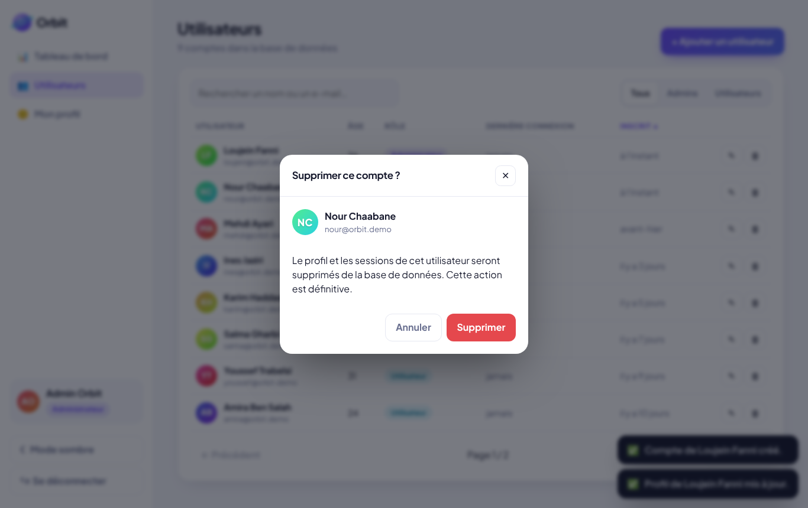
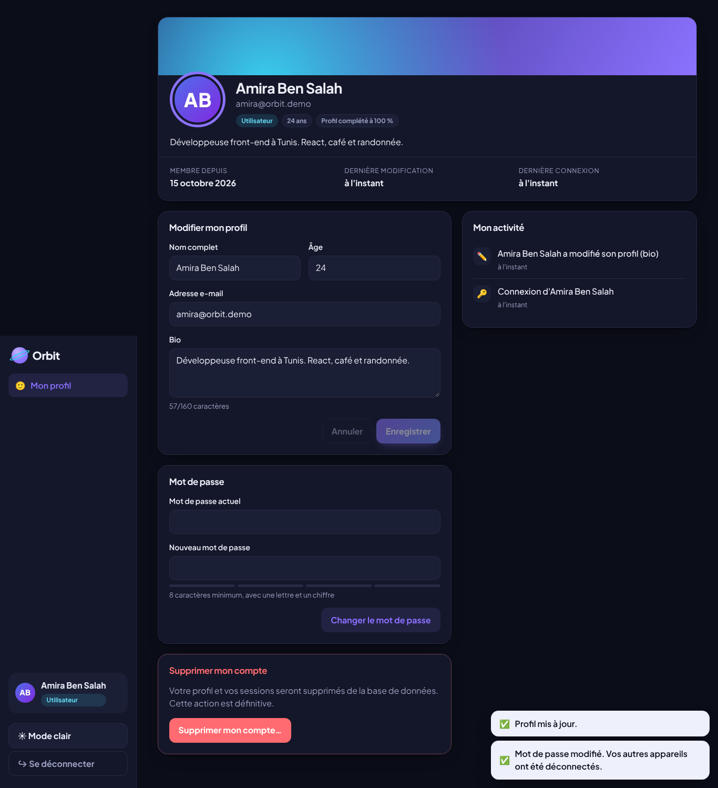
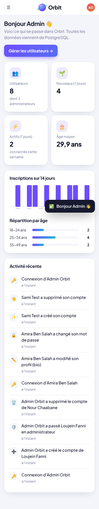

# Task 6 — Full Stack Application: « Orbit », User Management System

**SaiKet Systems · Full Stack Development Internship** — Loujein Fanni

> 🇫🇷 **Orbit** réunit un front-end **React**, une API **Express** et une base **PostgreSQL** dans un système de gestion des utilisateurs. Chacun peut **ajouter, voir, modifier et supprimer son profil**, et les administrateurs gèrent tous les comptes. La **connexion sécurisée** (l'option de la tâche) est incluse.
>
> 🇬🇧 **Orbit** combines a **React** front end, an **Express** API and a **PostgreSQL** database into a user management system. Everyone can **add, view, update and delete their profile**, and administrators manage every account. **Secure login** (the optional part of the task) is included.



## Requirements checklist

| Requirement | Where |
|---|---|
| Combine front-end and back-end | React (Vite) in `client/` + Express in `server/`. In production, one server delivers both |
| User Management System | Admin pages *Dashboard* and *Users*, plus the *My profile* page |
| **Add** a profile | Sign-up page (`POST /api/auth/register`), and admin creation (`POST /api/users`) |
| **View** a profile | Profile card (`GET /api/me`) and the admin users table (`GET /api/users`) |
| **Update** a profile | Profile form (`PATCH /api/me`), password change, and admin edit (`PATCH /api/users/:id`) |
| **Delete** a profile | "Delete my account" with password confirmation (`DELETE /api/me`), and admin delete (`DELETE /api/users/:id`) |
| Front-end displays data from the database | Everything comes from PostgreSQL: users, statistics (SQL `COUNT`, `AVG`, `GROUP BY`, `generate_series`), activity log (`JOIN`) |
| *Optional: login authentication* | ✅ Sessions in an HttpOnly cookie, scrypt password hashes, user/admin roles, brute-force protection |

## Features

**For everyone**
- Sign up, log in and log out.
- Profile card with an avatar, completion percentage, sign-up date and last login.
- Edit your name, email, age and bio, with checks both in the browser and on the server.
- Change your password, with a strength meter. Your other devices are logged out automatically.
- Delete your account (password required).
- **My activity**: the history of your own actions.

**For administrators**
- **Dashboard**: user count, new and active users this week, average age, a chart of sign-ups over 14 days, the age breakdown, and the **activity log** of the whole app.
- **Users** page:
  - instant search (name or email), filter by role, sortable columns, pagination;
  - the filters are kept in the URL;
  - create and edit in a modal: role, password reset;
  - delete with a confirmation step.
- **Safeguards**:
  - an admin cannot change their own role or delete their own account from the admin page;
  - there is always at least one administrator;
  - **the first account created becomes the administrator**.

**Interface**
- Light and dark mode, and responsive layout (side menu on mobile).
- Notifications, accessible modals, and an "orbit" animation on the login page.

## Security

| Measure | Detail |
|---|---|
| Hashed passwords | `scrypt` (built into Node.js) with a random salt. The password is never stored |
| Sessions | Random token in an **HttpOnly, SameSite=Lax** cookie (also `Secure` in production). The database only keeps its **SHA-256 hash**. Sessions expire after 7 days |
| Brute force | 5 failed attempts per email and IP lead to an error **429** for 15 minutes |
| No account enumeration | The same message and the same timing for an unknown email or a wrong password |
| Permissions | `requireAuth` and `requireAdmin` on the server. Hiding buttons in React is not enough |
| SQL | Parameterised queries everywhere, and a whitelist for sortable columns |
| Database | Constraints (`UNIQUE`, `CHECK`, foreign keys with `ON DELETE CASCADE` / `SET NULL`) |
| HTTP | `X-Content-Type-Options`, `X-Frame-Options`, JSON required, 10 KB body limit |

## Architecture

```
task-6-fullstack-app/
├── package.json            # npm workspaces: server + client
├── render.yaml             # Render Blueprint (database + app)
├── server/                 # Express 5 + PostgreSQL
│   ├── sql/migrations/     # 001 users, 002 sessions, 003 activity
│   ├── src/
│   │   ├── app.js          # API under /api + serves the React build
│   │   ├── routes/         # auth.js, me.js, users.js
│   │   ├── services/       # users (SQL), sessions, activity, passwords
│   │   ├── middleware/     # auth, rateLimit, common (errors, headers…)
│   │   ├── validation/     # server-side checks
│   │   └── db/             # pool, migrations, demo data
│   └── tests/api.test.js   # 18 integration tests (real PostgreSQL)
└── client/                 # React 19 + React Router + Vite
    └── src/
        ├── api/client.js   # fetch → API
        ├── auth/           # AuthContext (who is logged in)
        ├── components/     # Layout, Guards, Modal, Avatar, Charts…
        ├── pages/          # Login/Register, Profile, AdminDashboard, AdminUsers
        └── test/           # 9 tests (Vitest + Testing Library)
```

**API endpoints**

| Group | Endpoints |
|---|---|
| Authentication | `POST /api/auth/register`, `POST /api/auth/login`, `POST /api/auth/logout`, `GET /api/auth/me` |
| My profile | `GET /api/me`, `PATCH /api/me`, `PUT /api/me/password`, `DELETE /api/me`, `GET /api/me/activity` |
| Admin | `GET /api/users` (`?search=&role=&sort=&page=&limit=`), `GET /api/users/stats`, `GET /api/users/:id`, `POST /api/users`, `PATCH /api/users/:id`, `DELETE /api/users/:id`, `GET /api/activity` |
| Other | `GET /api/health` |

## Run it locally

You need **Node.js 22.12+** and **PostgreSQL 14+**.

```sql
-- in psql or pgAdmin
CREATE ROLE saiket LOGIN PASSWORD 'saiket' CREATEDB;
CREATE DATABASE orbit OWNER saiket;
CREATE DATABASE orbit_test OWNER saiket;   -- for the tests
```

```bash
cd task-6-fullstack-app
npm install
cp server/.env.example server/.env          # check DATABASE_URL
npm run dev                                  # API :3000 + React :5173 → open http://localhost:5173
```

The first start creates the tables and the **demo accounts** (password `Demo1234`):
- administrator: `admin@orbit.demo`
- user: `amira@orbit.demo`

The login page has buttons that fill these in for you.

Other commands:

```bash
npm test            # 18 server tests (PostgreSQL) + 9 React tests
npm run build       # build React into client/dist
npm start           # production: http://localhost:3000 serves the API and the app
npm run db:reset    # empty the database and recreate the demo accounts
```

## Deploy on Render

Render → **New → Blueprint** → choose this repository, with the Blueprint path set to `task-6-fullstack-app/render.yaml`. This creates the PostgreSQL database and the web service:

| Field | Value |
|---|---|
| Build Command | `npm install --include=dev && npm run build` |
| Start Command | `npm start` |

> A free Render PostgreSQL database is temporary. For a long-lasting demo, use [Neon](https://neon.tech) (free) and set `DATABASE_URL` with `DATABASE_SSL=true`. In real use, set `SEED_DEMO=false`.

## Tests

- **Server, 18 tests** against a real PostgreSQL database:
  - sign-up and HttpOnly cookie, scrypt hash, validation;
  - wrong password, brute force (429), logout;
  - first account becomes admin, profile update, password change (other sessions revoked), account deletion;
  - permissions (401 / 403), list, search, filters, admin CRUD;
  - last-admin protection, statistics, activity log.
- **Client, 9 tests**:
  - validation rules and activity sentences;
  - redirect to the login page, wrong password then login, sign-up errors from the browser and the server;
  - a regular user cannot reach the admin pages.
- An **end-to-end run in a real browser** (Playwright) went through the whole flow: admin, user, sign-up, account deletion, mobile.

## Screenshots

| Login | Users (admin) | My profile |
|---|---|---|
|  |  |  |

| Validation | Delete confirmation | Dark mode | Mobile |
|---|---|---|---|
|  |  |  |  |
